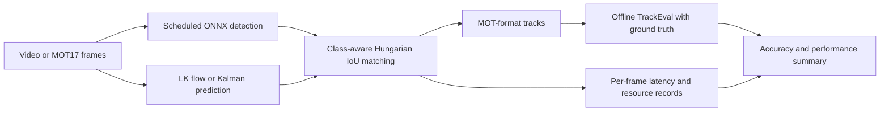

# Architecture

> Current scope (2026-10-18): Current primary runtime: AsyncTrackerRuntime with one state-owning tracking thread, a detector/replay worker, bounded latest-pending queues and cropped ROI features. The synchronous flow below documents retained controls; their measurement boundaries differ from capture-to-output async timing. See [verified performance](verified-performance.md).

The pipeline receives sequential BGR images and produces persistent track IDs
and bounding boxes. The detector accepts batch-one float32 YOLOv8/11 detection
ONNX exports. Sparse optical flow and the eight-state Kalman tracker are
alternative tracking strategies.

## Module contracts

| Module | Responsibility | Output |
|---|---|---|
| `src/detector.py` | Letterbox, RGB conversion, ONNX inference, class filtering, NMS | `(N,6)` xyxy/score/class detections |
| `src/datasets/mot17.py` | Validate sequence metadata and frame IDs; decode lazily | Frames, original IDs, timestamps and metadata |
| `src/tracker.py` | LK translation and forward/backward consistency | Track objects with ID, box, score and heuristic confidence |
| `src/sort_tracker.py` | Eight-state Kalman prediction and Hungarian matching | Track objects with ID, box and score |
| `src/pipeline.py` | Schedule inference and time stages | Tracks and per-frame instrumentation |
| `src/benchmark.py` | Log process CPU, RSS, latency and throughput | `frames.jsonl` and `summary.json` |
| `scripts/evaluate_tracking.py` | Offline MOT17 pedestrian evaluation | HOTA, MOTA, IDF1, IDSW and evaluator reports |

Boxes use zero-based xyxy internally. MOT export uses one-based x/y and width/
height, with the frame index preserved. Ground truth is used only offline.

## LK confidence and scheduling

LK tracks corners inside each detected box. Forward/backward error checks reject
inconsistent correspondences; point survival and motion coherence contribute
to cumulative confidence since the last detector refresh. Median point motion
translates the box. Confidence is a heuristic and is not a calibrated probability.

Baseline detects every frame. Adaptive detects if there are no visible tracks,
confidence falls below the threshold, normalized displacement exceeds its limit,
or the maximum interval is reached. The weakest visible track can trigger a
refresh for the whole frame. Fixed mode detects exactly on frames `1, 1+K, ...`.

LK uses translation only and can struggle with scale changes, occlusion, and
coherent drift. Association uses class-aware IoU, with no appearance embedding
or re-identification. Lost IDs are retained for a bounded number of detector
updates and unmatched boxes are suppressed.

## Eight-state SORT variant

The Kalman state is `[cx, cy, area, ratio, vx, vy, varea, vratio]`, with time in
video frames. The requested aspect-ratio velocity makes this an eight-state
variant; the original SORT implementation uses seven states. Covariance updates
use the Joseph form, and box area/aspect ratio are constrained positive.

`step(None)` means inference was deliberately skipped: confirmed tracks are
predicted and emitted. An empty `(0,6)` detection array means inference ran but
found no objects: unmatched outputs are suppressed until reacquired. `max_age`
counts frames since the last match. `min_hits` counts matched detector observations.
These choices are explicit experimental parameters, not an exact reproduction
of every lifecycle rule in the original SORT.

## Measurement boundaries

Pipeline latency excludes input decoding and file export. Measured throughput
includes decoding, processing, MOT/JSONL output, and resource instrumentation.
Model loading and detector warmup are excluded; tracker initialization is measured.
CPU usage is process CPU time divided by wall time. RSS is sampled resident
memory. Neither value measures watts or joules.

Offline evaluation preserves performance measurements and adds tracking metrics.
MOT17 distractor preprocessing stays enabled. Complete frame ledgers are required,
including frames without predictions. Evaluation time is excluded from throughput.
