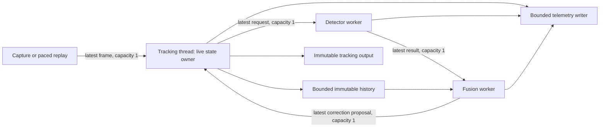

# Asynchronous Streaming Tracking Runtime

> Current scope (2026-10-18): This is a historical design blueprint. The implemented API, SLO contract and current evidence take precedence over planned component descriptions. See [verified performance](../../docs/verified-performance.md).

Architecture draft · 12 October 2026 · Apple Silicon ARM64

This document specifies the new runtime and its implementation sequence. This is the original design blueprint. `src/async_pipeline.py` and the scheduler/evaluation runners now implement the core design; sections describing separate workers remain proposed extensions. The synchronous pipeline remains the reproducibility reference. The existing C++ gating engine is historical work, not a dependency of the new runtime.

The scheduler contract and four policies are now implemented in `src/schedulers/`; their API and limitations are documented in `docs/schedulers.md`.

Implementation update: `src/async_pipeline.py` now provides `AsyncTrackerRuntime`, with bounded queues, leased history, and source-time correction preparation in a combined detection/replay worker. See `docs/async-runtime.md` for the implemented API, telemetry limits, and validation. Separate capture/fusion/telemetry workers remain future components. Full-sequence runners now exist in `scripts/run_async_evaluation.py` and `scripts/ablation_policies.py`; useful async fidelity remains unqualified.

## 1. Evidence and engineering objective

The completed MOT17-04 baseline has mean stage times of 50.08 ms for grayscale conversion/flow, 90.43 ms for detector execution, and 205.79 ms for detector-update work. The last stage includes both association and feature reseeding; its timer does not isolate Hungarian matching. Baseline pipeline p99 is 541.43 ms; the initial adaptive run has p99 1,008.71 ms. These values come from `results/baseline-04/` and `results/adaptive-04/`, not a new profiler run.

Source inspection identifies three candidates for profiling: nested Python IoU loops, two LK calls per track, and one full-image mask plus `goodFeaturesToTrack` call per refreshed track. Subsequent profiling isolated feature selection at 114.62 ms/frame; cropped ROI extraction reduced its native-call attribution to 1.31 ms/frame. The measured flow stage already exceeds 33 ms. Moving inference to another thread cannot alone establish 30 FPS or a 33 ms deadline.

The objective is sustained, fresh tracking output under explicit overload, with bounded memory, causal detection fusion, and measured accuracy. Set the source cadence independently from the output deadline: a 30 Hz source has a 33.333… ms period; a strict 33 ms deadline and a 50 ms deadline are separate test conditions. macOS and the proposed Python runtime provide soft real-time behavior, not a hard scheduling guarantee.

## 2. Proposed directory changes

```text
src/
  async_pipeline.py              # live-state owner and bounded frame-step orchestration
  schedulers/
    __init__.py                  # explicit policy registry
    base.py                      # BaseScheduler, context, decision, lifecycle events
    fixed_k.py                   # FixedKPolicy
    kalman.py                    # KalmanUncertaintyPolicy
    heuristic.py                 # AdaptiveHeuristicPolicy
    oracle.py                    # offline-only OraclePolicy
  runtime/
    packets.py                   # timestamped frame/request/result/proposal contracts
    mailbox.py                   # bounded replace-latest transport and counters
    capture.py                   # camera or paced MOT replay, canonical frame ledger
    detector_worker.py           # exclusively owns inference session
    fusion_worker.py             # historical association and bounded motion replay
    history.py                   # bounded immutable grayscale/state history
    lifecycle.py                 # start/stop, worker failures, health state
    telemetry.py                 # bounded event transport and writer
  tracking/
    streaming_tracker.py         # time-aware LK + optional covariance state
    association.py               # vectorized, class-gated pairwise IoU
    features.py                  # ROI feature selection and replenishment
    fusion.py                    # proposal validation and atomic state commit
  evaluation/
    streaming_metrics.py         # deadline, coverage, freshness, CPU/RSS summaries
    replay.py                    # deterministic virtual-clock and paced replay
scripts/
  profile_tracking.py
  run_streaming.py
  ablation_policies.py
  evaluate_streaming.py          # wraps TrackEval with streaming coverage checks
csrc/
  include/tracking/              # only measured hot paths selected for migration
  src/tracking/
  tracking_bindings.cpp          # separate extension target from legacy gating
configs/streaming/
  cpu_reference.json
  policies.json
tests/
  test_async_runtime.py
  test_delayed_fusion.py
  test_schedulers.py
  test_streaming_metrics.py
docs/design/async-runtime-blueprint.md
```

Reuse `src/detector.py`, MOT17 adapters, model checksums, and TrackEval staging. Reuse the pairwise IoU formula in `src/sort_tracker.py` after parity checks. Do not move or rewrite existing modules to establish the new namespace. New code must not import the optional gating extension. Keep historical results and the current grid search intact; no legacy worker, fingerprinted source, or running process changes are required by this design.

## 3. Ownership and data flow



The detector worker owns one warmed inference session and never accesses mutable tracker objects. The fusion worker operates on immutable history snapshots and produces proposals; it never changes live tracks. Only the tracking thread allocates track IDs, changes anchor revisions, updates covariance, retires tracks, and commits corrections. Capture and telemetry are separate workers so camera reads, decode, and disk writes cannot silently block the tracking step.

Begin with threads and one inference worker. Measure actual overlap and GIL contention across preprocessing, inference, postprocessing, and tracking. Python threads do not automatically parallelize Python loops; move measured loops to vectorized/native implementations or use an isolated process only if thread overlap proves insufficient. Do not assume a free-threaded interpreter or convert the project environment for this milestone.

## 4. Packet contracts and bounded transport

Use frozen records with explicitly owned, immutable arrays. A frozen dataclass does not freeze NumPy storage. Camera-buffer reuse requires a copy or a retained buffer lease; `writeable=False` alone does not prevent another alias from modifying the allocation.

| Record | Required fields |
| --- | --- |
| `FramePacket` | stream epoch, source frame ID, source timestamp, monotonic capture timestamp, delivery timestamp, BGR buffer lease, dimensions |
| `DetectionRequest` | request ID, frame packet, admitted time, expiry, policy reason, source tracker revision, model/config hash |
| `DetectionResult` | request/source IDs and epoch, source capture time, inference start/end, publish time, owned `(N,6)` detections, provider, status/error |
| `StateSnapshot` | frame ID/time, immutable boxes/classes/IDs/incarnations, per-track anchor revision, covariance, flow validity, transform history |
| `CorrectionProposal` | source and replay-target IDs, preparation timestamps, matched residuals, candidate births/points, expected anchor revisions, replay validity, expiry |
| `TrackingOutput` | source ID/time, publish time, immutable boxes/IDs, confidence, anchor age, validity, overload/deadline status |

Use `perf_counter_ns()` for all local durations and deadlines. Keep dataset/camera source time separate; do not subtract timestamps from unrelated clock domains. Record capture timestamp provenance: device exposure timestamp when calibrated to the monotonic domain, otherwise host receipt time with that limitation disclosed.

All data mailboxes have capacity one initially; one additional request can be in flight. `publish_latest()` atomically replaces a pending item, returns the evicted ID, and updates accounting. `try_take()` never waits for future work. Implement the compound replacement under one short lock; do not use `qsize()`/`empty()` as synchronization or hold a lock while running OpenCV/ORT. Locks still have finite contention: instrument acquisition time and use nonblocking admission/drop where needed. Python's [queue documentation](https://docs.python.org/3.13/library/queue.html) explains bounded insertion and the limitations of size inspection.

Default overload policy is latest-wins. Pending requests may be superseded; a running inference is allowed to finish and then validated for usefulness. This is not cancellation. Drop an expired request before inference and an expired result before replay. Track each request through exactly one terminal outcome: fused, rejected, superseded, failed, or shutdown-discarded. Report policy intent, admission, detector start/completion, and fusion separately.

Offer bounded FIFO only as a separately named experiment with a fixed capacity and maximum request age; never use an unbounded queue or make the tracker wait on `put()`. Capture drops and detector request drops are different events. Bound telemetry too: coalesce counters, report lost diagnostic events, and mark an evaluation incomplete if the canonical frame ledger or track export loses records.

History is bounded by both time and bytes, not just frame count. At 1920×1080, 15 grayscale frames alone occupy about 29.7 MiB. Reserve capacity for in-flight leases and snapshots; when pinned history exhausts the cap, reject replay work rather than allocate without limit. Select the horizon from measured service time and an explicit accuracy/freshness tradeoff.

## 5. `src/async_pipeline.py`: orchestration blueprint

Proposed public contract, not an executable implementation:

```python
class AsyncPipeline:
    def __init__(self, tracker, scheduler, detector_factory, runtime_config,
                 history, telemetry, clock): ...
    def start(self) -> None: ...
    def step(self, frame: FramePacket) -> TrackingOutput: ...
    def health(self) -> RuntimeHealth: ...
    def close(self, drain: bool = False, timeout_s: float = 2.0) -> ShutdownReport: ...
```

`start()` creates workers, builds/warms the session in its owning worker, and waits for readiness outside the measurement window. `step()` must never call the detector, await its future, join a worker, run historical replay, or write files. It can still overrun through tracking or a native call; the deadline is measured, not guaranteed by this API.

The step sequence is:

1. Validate monotonic source IDs within the stream epoch. Detect gaps and dimension changes. A restart creates a new epoch and invalidates all previous work.
2. Establish the absolute deadline from capture time and budget. Convert grayscale once; propagate live tracks from the last consumed image with actual elapsed time. Cap track/point counts and log caps. Large gaps invalidate LK support and trigger reacquisition rather than silently extrapolating trusted state.
3. Admit the immutable grayscale frame to bounded history, subject to its byte and lease limits.
4. Poll at most one correction proposal. Validate epoch, source order, expiry, history, per-track revision, and replay support. Apply only a bounded current-frame correction transaction. If insufficient estimated headroom remains, defer within expiry or reject; record the outcome.
5. Publish the final post-correction state snapshot for this frame, then build `ScheduleContext`, call the policy, and ask the shared admission controller to publish/replace a request. Bind each admitted request to that exact snapshot version. Policies express intent; capacity and expiry are runtime decisions.
6. Publish one immutable output and enqueue timing events. No retroactive modification of an already published output is permitted.

Core pseudocode:

```text
step(packet):
    deadline = packet.capture_ns + budget_ns
    propagation = tracker.propagate(packet, bounded_work_limits)
    history.admit_gray_frame(packet, propagation.gray)
    proposal = corrections.try_take()
    if proposal exists:
        validation = validate(proposal, tracker, packet, deadline)
        if validation.accepts and estimated_commit_fits(deadline):
            commit_current_time_correction(proposal)
        else:
            account_rejection_or_bounded_deferral(proposal)
    history.publish_snapshot(packet, tracker.snapshot())
    intent = scheduler.decide(context_after_correction())
    outcome = admission.try_submit(intent, packet)
    scheduler.on_event(outcome)
    publish_output_and_nonblocking_telemetry()
```

Estimate admission costs from conservative rolling quantiles, with configured caps and headroom. This cannot preempt an unexpectedly slow native call. Always log actual overrun, including an over-budget frame with no detector work. Do not busy-wait for a proposal, catch up by spinning after missed deadlines, or treat empty predictions as successful tracking.

## 6. Delayed detection fusion

Detection boxes belong to source frame `s`, not arrival frame `t`. Calling the existing `LKTracker.update(gray_t, detections_s)` would anchor old boxes to a new image and corrupt both association and feature initialization. It is not a valid asynchronous adapter.

The fusion worker associates detections against the snapshot at `s`, with class gates and bounded vectorized IoU, then prepares corrections at replay target `u ≤ t`. Initially use the existing translation model explicitly. For a surviving matched track:

\[
\Delta b_i = b^{\mathrm{det}}_{i,s} - \widehat b_{i,s},
\qquad
b^{\mathrm{corrected}}_{i,t} = \widehat b_{i,t} + \Delta b_i.
\]

This residual transport assumes the same accumulated translation for the detected and tracked box. It preserves current motion instead of snapping to `b_det,s`; it is an approximation, particularly under scale change, camera motion, and occlusion. Validate on synthetic motion and MOT data. An affine/Kalman alternative requires its own measurement model and ablation; do not substitute a translation residual into a covariance update without defining its noise.

For births and feature refresh, seed on the detector's source ROI off-thread and replay sparse points through a leased grayscale history to `u`. Bound replay frames, points, and wall time. Invalidate proposals with missing history, excessive forward–backward error, insufficient points, or excessive source age. The worker must not chase the live head indefinitely.

At commit, accept replay support only within a configured short target lag; project candidate points from `u` to `t` in a bounded batch when needed. Admission accounts for this extra LK work. Require current support before allocating birth IDs; deduplicate births against current tracks because another correction may already have introduced the object. Discard unsupported stale births instead of inventing their current location. Matched box-only corrections can be committed without reseeding immediately; replenish points on a measured quota across later frames.

Validate every track ID plus incarnation/anchor revision; a proposal for a retired track cannot resurrect it. Discard results older than the last committed source observation. Apply a proposal at most once. Stage changes before atomic commit so failed support checks cannot leave half-updated state. A detector miss at `s` does not establish that an object is absent at `t`; record negative evidence at its observation time and use a time-based lifecycle.

A delayed observation must not reset detector age or confidence to a fictitious current-time value. Carry source age and replay reliability into the posterior. For the uncertainty policy, update at observation time and replay state/covariance to the present, or use a documented out-of-sequence measurement formulation. If that history is unavailable, reject the covariance update.

## 7. `src/schedulers/`: policy contracts

Schedulers run on the tracking thread and own only policy state. They do not read frames, invoke the detector, mutate tracks, access ground truth during deployment, or inspect queues directly. Missing capability is a configuration error, not a silent policy fallback.

```python
class BaseScheduler(ABC):
    def reset(self, stream_info: StreamInfo) -> None: ...
    def decide(self, context: ScheduleContext) -> ScheduleDecision: ...
    def on_event(self, event: SchedulerEvent) -> None: ...
    def describe(self) -> dict: ...
```

`ScheduleContext` contains source frame/time, visible-track count, confidence/flow validity, normalized displacement, normalized uncertainty if supported, last requested/admitted/started/fused source IDs, elapsed time since last fused source observation, worker availability, pending age, detector service-time estimate, and remaining frame budget. Use explicit `None` for unavailable signals.

`ScheduleDecision` contains `request_detection`, reason, urgency, and maximum useful source age. `SchedulerEvent` distinguishes admitted, replaced, rejected, started, completed, fused, and stale-discarded requests. State changes use these events; merely asking for inference must not advance `last_fused`. The admission controller applies identical resource rules across deployable policies.

| Policy | Trigger and required state | Experimental interpretation |
| --- | --- | --- |
| `FixedKPolicy(k)` | Request at `(source_frame_id − 1) mod k = 0`, including the first frame; no opportunistic trigger | Deterministic intent baseline; requests on dropped source frames remain documented unmet opportunities |
| `KalmanUncertaintyPolicy` | Bootstrap with no tracks; trigger when normalized position uncertainty exceeds a threshold, or a shared maximum source-age guard expires | Requires the same covariance-capable tracker used by the other policies in the controlled comparison |
| `AdaptiveHeuristicPolicy` | Bootstrap, flow failure, confidence threshold, displacement threshold, maximum source age; explicit cooldown/hysteresis | Motion-based deployable policy; compare single worst-track and robust quantile rules as separate configurations |
| `OraclePolicy` | Offline selection using future replay/ground-truth scoring and a fixed inference budget | Noncausal diagnostic reference, never a deployment result |

For uncertainty, use dimensionless position covariance rather than the raw trace of an eight-state matrix mixing pixels, box area, and aspect ratio:

\[
U_t = \max_i\frac{\lambda_{\max}(P^{xy}_{i,t})}
{\max(1,\operatorname{diag}(b_{i,t})^2)}.
\]

Here `diag(b)` is the Euclidean box diagonal in pixels. Predict using elapsed seconds and appropriately calibrated velocity/process-noise units; the existing SORT filter uses frames and cannot be passed seconds unchanged. LK measurements also need noise calibration if used to reduce covariance. Keep uncertainty unavailable for a tracker that lacks a valid covariance model.

Define the oracle precisely before implementing it: for a small finite candidate schedule set at a fixed detector-call budget, replay cached detector observations with the same simulated service/queue/fusion delays and choose the best completed schedule by HOTA subject to the deadline/coverage constraints. Ties favor MOTA and then lower deadline misses. This yields the hindsight-best schedule **within the enumerated set**, not a proven global upper bound on all possible policies. Report future/GT access and candidate count. An instantaneous detector or GT-box oracle is a separate ceiling that is not latency-comparable.

Run all four policies with one tracker/fusion/backend configuration. A legacy SORT-versus-LK experiment changes the tracker as well as scheduling and must be reported separately. Parameterize `FixedKPolicy` with `k=1,2,3,5,10`; record requested versus realized detector cadence under overload.

## 8. Profiling and hot-path migration

First add isolated profiling instrumentation to the new runner or a tracker adapter, without changing active legacy search inputs. Do not run competing heavy benchmarks while the old timing experiment is active. Profile decoded-frame replay and paced replay separately; use per-stage monotonic timings for tails and sampling/call profiling for attribution, recording profiler overhead.

Split timings into grayscale/copy, forward LK, backward LK, point filtering, motion reduction, IoU construction, Hungarian solve, lifecycle bookkeeping, feature masks, feature selection, coordinate conversion, proposal preparation, commit, and telemetry admission. Record track count, points, matrix dimensions, ROI pixels, replay depth, and allocation/copy bytes. Report distributions for detector frames versus propagation-only frames and crowded versus sparse frames; do not add stage quantiles to estimate end-to-end p99.

Optimization order:

1. Replace nested scalar IoU with the existing vectorized formulation. Preserve class gates, threshold ties, empty input, zero-area checks, and association parity. Cap dense matrix dimensions; spatial candidate pruning is a separate accuracy-affecting option.
2. Seed features on cropped grayscale ROIs, adding the crop origin back to global coordinates. Avoid full-frame masks for each box. This changes corner-selection boundaries; test border cases and compare track survival and HOTA, not only arithmetic parity.
3. Pack ragged track points with offsets for batched forward/backward LK calls, sharing image preparation. Rebuild per-track validity and confidence independently. Benchmark actual OpenCV behavior; do not assume pyramid reuse or a speedup without measurement.
4. Replenish on low-support tracks with a quota; avoid refreshing every track on every detector result. Retain full-refresh as an ablation.
5. Move only remaining measured kernels into a separate native extension: candidate construction, point reduction, or replay. OpenCV LK and SciPy assignment already execute native kernels; rewriting them requires measured benefit. Validate dtype/stride contracts, ownership, GIL release, output allocation, and ARM64 parity.

Control OpenCV and ORT thread counts independently. Start with one ORT intra-op thread, sequential execution, and one OpenCV thread; sweep a small, recorded set after correctness. ORT thread pools and spinning can compete with tracking, so measure deadline tails with the worker active. [ORT thread management](https://onnxruntime.ai/docs/performance/tune-performance/threading.html).

Evaluate CoreML EP only as a separate backend experiment after the CPU reference. Log actual providers, supported graph partitioning/fallback, precision, cache/warmup behavior, and model equivalence. Availability does not establish ANE placement or lower latency. [CoreML execution provider](https://onnxruntime.ai/docs/execution-providers/CoreML-ExecutionProvider.html).

## 9. Latency-budgeted evaluation

For captured frame `i`, define capture time `c_i`, tracker start `s_i`, and output publication `o_i` on one monotonic clock:

\[
L_i^{\mathrm{output}}=(o_i-c_i)/10^6,
\quad L_i^{\mathrm{work}}=(o_i-s_i)/10^6,
\quad d_i=c_i+B\,10^6.
\]

Report capture-to-output and tracker-work p50/p95/p99 separately. Queue wait is `s_i − c_i` only when capture timing includes delivery; retain delivery/start components to distinguish capture buffering. Detector telemetry records queue wait, preprocess/inference/postprocess, result age at fusion, replay, and commit. Long detector service time can coexist with low tracker-work latency; freshness and accuracy reveal the cost.

Use two deadline measures:

\[
R_{\mathrm{published}}=\frac{\#\{i:o_i\text{ exists and }o_i>d_i\}}{N_{\mathrm{published}}},
\qquad
R_{\mathrm{source}}=\frac{\#\{i:o_i\text{ missing or }o_i>d_i\}}{N_{\mathrm{source}}}.
\]

The second measure counts dropped frames and prevents an overloaded runtime from appearing successful by reporting only fast survivors. Also report output coverage, source/capture/consumed/published counts, delivered FPS over measurement wall time, worker detector FPS, and age since the last fused source observation. Successful publication does not imply an accurate track. A steady camera-paced output rate near 30 FPS is a cadence result; maximum throughput requires an additional unpaced experiment.

`frames.jsonl` records canonical source IDs, timestamp provenance, all stage times, output status, deadline flags, gap/drop reasons, queue/replay state, anchor age, track counts, policy intent and admission, CPU sample status, and RSS samples. `events.jsonl` records request/result/proposal lifecycles. `summary.json` contains versioned configuration, counters, both deadline measures at 33 and 50 ms, quantile sample counts, coverage, HOTA/MOTA/IDF1/IDSW, model/source/code hashes, provider/thread configuration, clock/replay mode, and completion status. Keep power null without a separate measurement.

For TrackEval, retain the full original sequence length and frame IDs. Evaluate predictions published by each frame deadline; late output is unavailable for that frame in the deadline-valid stream. Missing or dropped frames have no prediction rows, but remain in the GT/frame ledger. Produce a second arrival-output evaluation as a diagnostic and label it separately. Never retroactively insert replayed corrections into earlier MOT rows. Validate the entire ledger before [TrackEval](https://github.com/JonathonLuiten/TrackEval) staging.

Use MOT17-02 for development and reserve MOT17-04 for a fixed validation protocol, while acknowledging that both sequences have already informed earlier work and therefore are not a pristine held-out test set. Add untouched sequences for generalization. Use identical resolution, model, class filters, tracker, queue limits, fusion rules, and deadline accounting across policies. Randomize order; use at least three full timing repetitions, with runs sequentially scheduled under comparable load. Bootstrap whole runs or temporal blocks for confidence intervals, not independent frames.

Two complementary modes are required: deterministic virtual-clock replay with declared service traces for reproducible causality/overload tests, and paced wall-clock replay for real contention and deadlines. Persist actual admission and arrival traces. Neither synthetic delays nor cached detections establish hardware throughput.

## 10. Lifecycle and failure handling

States are `created → starting → running → draining/stopping → stopped`, with a visible `failed` transition. Worker exceptions travel on a dedicated bounded control channel and cannot disappear in a background traceback. Detector failure places the runtime in explicitly degraded tracking-only mode with an age limit, or fails the run according to configuration; outputs must expose that state.

Use a stop event and bounded waits. `close()` stops admission, closes/wakes mailboxes, optionally drains useful work outside the measurement window, joins with timeouts, and writes complete/partial status. An in-flight ORT call may not be interruptible by a Python stop event; a timeout is reported as an unsuccessful shutdown, not a clean join. Never free leased buffers while a worker can still access them. If forced termination becomes necessary, process isolation is the appropriate later design rather than claiming threads can be killed safely.

Camera disconnect, dimension change, and sequence restart increment the epoch or terminate the run. Results from a previous epoch are rejected. Startup, warmup, steady state, and drain are separately timed; end-of-stream draining cannot improve earlier output deadlines or retroactively improve accuracy.

## 11. Incremental implementation and acceptance gates

| Milestone | Deliverable | Required evidence before expanding scope |
| --- | --- | --- |
| A: profile and contracts | stage profiler, packets, bounded mailbox, metrics definitions, FixedK scheduler | exact hot-path distributions; fake-clock queue/counter tests; no legacy behavior change |
| B: decoupled execution | CPU detector worker, readiness/error propagation, paced capture, tracking-only output loop | variable-delay/failure tests; bounded queues/RSS; no inference wait in frame step; truthful drops/deadlines |
| C: delayed fusion | snapshots, residual transport, bounded birth replay, anchor revisions | synthetic translation with known delayed boxes; occlusion, gaps, retirement, duplicates and stale epochs; actual MOT accuracy |
| D: policy comparison | covariance support, heuristic/hysteresis, offline oracle harness | FixedK source-ID cadence; covariance units and PSD; delayed updates; same runtime limits across policies |
| E: measured optimization | vectorized/ROI/batched/native kernels selected by profiles | output parity where applicable; feature-boundary accuracy studies; p95/p99 and deadline improvements under contention |
| F: systems ablations | policy × queue × fusion × backend experiments | complete ledger, repeat statistics, HOTA/MOTA/IDF1/IDSW, deadline-valid accuracy, coverage and freshness |

Start with milestone A and the simplest worker in B. Do not claim camera-rate behavior until paced measurements show it. Predeclare acceptable fidelity loss and deadline/coverage thresholds before selecting a configuration. The earlier inference-reduction target can remain a secondary metric, but minimizing detector calls is not sufficient when observations become stale.

Critical tests include: inference slower than camera cadence; no detections; detector exception; result arrival during shutdown; restart with an old result pending; frame gaps; full telemetry; bounded history with pinned buffers; duplicate proposal; source-time versus arrival-time association; scale change invalidating translation assumptions; birth replay failure; and Kalman uncertainty with delayed, rejected measurements. Threaded tests use events/barriers instead of fragile sleeps; deterministic fake clocks establish event ordering, followed by paced real-worker integration tests.

## 12. Reporting and repository status

This pivot changes the research claim to deadline-aware streaming tracking with delayed observations and policy comparison. Preserve the previous report as an initial synchronous-pipeline draft until new experiments justify revising its title, abstract, and results. Historical C++ gating validation is not evidence for the new runtime. No new source module, native kernel, real-time result, benchmark run, or GitHub upload is implied by this architecture document.
