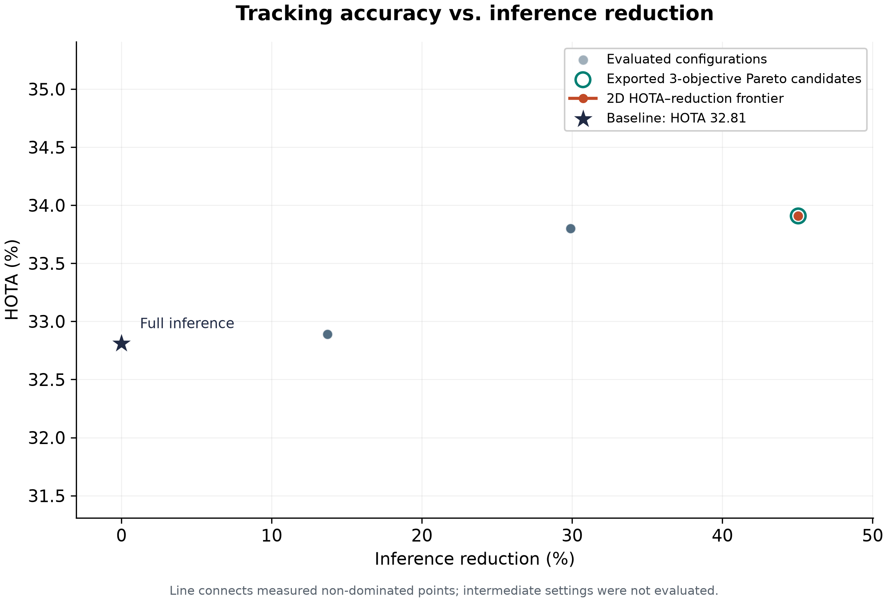

# Asynchronous Tracking-by-Detection on Apple Silicon: Scheduling, ROI Features, and Latency Qualification

**Yashas Vijay**  
*Technical report draft · updated 18 October 2026*

> **Evidence status.** The implemented asynchronous runtime maintained tracks on 600/600 MOT17-02 frames at 30.0 FPS, 26.21 ms capture-to-output p95 and 29.74 ms p99, with four deadline misses (0.67%). Useful fusion occurred in 125/177 completed background runs (70.6%). The complete raw artifacts are committed under `results/slos/mot17-02-fixed3-populated/` and rechecked against contract v3. This is one paced-replay result; it does not establish HOTA/MOTA, repeated-run reliability, power savings or physical-camera latency. The older empty-output result is superseded as tracking evidence.

## Abstract

We study asynchronous inference scheduling and localized feature selection for tracking-by-detection on Apple Silicon. A single-owner tracking thread exchanges bounded requests and correction proposals with a detector/replay worker. Sparse Lucas–Kanade flow propagates live tracks, while four scheduler policies control YOLO11n ONNX requests. Cropped ROI selection reduced native feature-call attribution from 114.62 to 1.31 ms/frame; a separate paired selector experiment measured a 98.58% reduction including mask/offset work. After synchronous cold-start and batched replay corrections, a 600-frame FixedKPolicy(3) MOT17-02 replay maintained nonempty tracks on every frame at 30.0 FPS, 26.21 ms p95 and 29.74 ms p99, with 0.67% deadline misses. Of 177 completed background runs, 125 accepted at least one correction, giving a useful fusion ratio of 70.6%. The verifier now requires ≥95% populated frames, and empty-scene recovery has a bounded synchronous retry cadence. These run-level measurements establish populated-tracker timing for this workload, not tracking accuracy or deployment-wide reliability.

**Keywords:** asynchronous vision; multi-object tracking; optical flow; bounded queues; tail latency; Apple Silicon.

## 1. Motivation and scope

Synchronous detector execution couples inference service time to frame latency. Reducing detector calls can improve average throughput, but it does not remove expensive tracking work or establish a bounded tail. The original MOT17-02 adaptive comparison reduced detector calls from 600 to 484 while throughput increased from 3.84 to 4.21 FPS. The modest result motivated stage attribution before further native optimization.

The current design separates source-frame publication from detector completion and constrains queues, history and replay work. Its research objective remains useful camera-rate tracking with retained HOTA/MOTA. A 50–60% inference reduction is an objective, not a demonstrated fidelity-preserving outcome. Correct publication timing and accurate persistent identities are independent requirements.

## 2. Method

### 2.1. Detection and source-time association

YOLO11n executes through ONNX Runtime's CPU provider with batch-one FP32 input. The wrapper letterboxes images to the model input, converts BGR to RGB, filters COCO person class 0 and applies NMS. The default confidence and NMS thresholds are 0.25 and 0.45. Class-aware IoU/Hungarian association operates on the detection request's source-time anchors rather than directly matching old detections to current boxes. There is no appearance embedding or re-identification model.

### 2.2. Sparse LK propagation

For a feature at pixel $\mathbf p$ and local motion $\mathbf v=(u,v)^\top$, brightness consistency gives

$$
\mathbf v^*=\arg\min_{\mathbf v}\sum_{\mathbf q\in\Omega(\mathbf p)}
\left[I_t(\mathbf q+\mathbf v)-I_{t-1}(\mathbf q)\right]^2.
$$

Linearization yields $G\mathbf v=-\mathbf b$, where

$$
G=\sum_{\Omega}\nabla I\nabla I^\top,
\qquad \mathbf b=\sum_{\Omega}\nabla I I_\tau.
$$

OpenCV's pyramidal LK estimates forward and backward motion. Points survive only with valid status, finite coordinates, image support and forward–backward error below the threshold. Median surviving displacement translates the box. For box $B_i=(x_1,y_1,x_2,y_2)$,

$$
d_i=\frac{\|\operatorname{median}_j(\Delta\mathbf p_{ij})\|_2}
{\max(1,\sqrt{(x_2-x_1)^2+(y_2-y_1)^2})}.
$$

Point survival, forward–backward error and motion coherence multiply cumulative track confidence between detector refreshes. This is a reliability heuristic, not a calibrated correctness probability. Translation cannot represent all scale, rotation or occlusion effects.

### 2.3. Localized feature selection

A full-frame output mask does not necessarily bound the image region on which corner responses are computed. The shared selector clips each active box, extracts a crop, constructs a crop-local mask, and calls `goodFeaturesToTrack` on the crop. It offsets selected coordinates back into the global frame and enforces strict fractional box bounds. Degenerate boxes and textureless crops return no points. The tracker and replay worker share this implementation.

Cropping changes image-boundary derivatives and selected corner populations. Faster extraction therefore requires new fidelity evaluation; passing containment tests does not establish unchanged HOTA.

### 2.4. Swappable scheduling

`BaseScheduler` returns a trigger flag, reason and metadata; admission and fusion events update distinct histories. Fixed-K requests source frames satisfying $(t-1)\bmod K=0$. The default heuristic requests detection when tracks are absent, the maximum interval expires, flow fails, confidence drops or displacement exceeds its threshold:

$$
g_t=\mathbb{1}\{\mathcal T_t=\varnothing\ \lor\ t-t_f\ge K
\ \lor\ \mathrm{flowfail}_t\ \lor\ \min_i c_i<\tau_c
\ \lor\ \max_i d_i>\tau_d\}.
$$

The Kalman policy uses normalized maximum center-position covariance,

$$
U_t=\max_i\frac{\lambda_{\max}(P_i^{xy})}{\max(1,\operatorname{diag}(B_i)^2)}.
$$

Its covariance is a scheduling signal rather than a proven statistical error bound. The current `OraclePolicy` reference requests every source frame through the same async delays. It has no ground-truth access and no theoretical optimality claim.

## 3. Streaming architecture

`AsyncTrackerRuntime` owns current LK tracks on the caller thread. `DetectionWorker` owns inference, source-time association, ROI reseeding and bounded historical replay. Request and result `queue.Queue` instances default to capacity one. A full queue replaces its oldest pending payload, releases the displaced history lease and records backpressure. Native inference already in flight is not cancelled. Source tracking frames continue through paced replay.

A leased grayscale history bounds retention. Matched detections produce source-box residuals transported to current propagated boxes; new births require current feature support. Epoch, source order, age, target lag, history continuity and anchor revision checks reject stale or incompatible proposals. Final commit work is bounded and admitted using soft deadline headroom. No retrospective correction improves a previously published track file.

The existing C++/pybind11 gating engine is optional historical work. It is not the central async optimization and is not required by this runtime. Separate fusion workers, process-isolated inference cancellation, calibrated smoothing and live capture-buffer management remain possible extensions.

## 4. Experimental protocol

Historical controls use MOT17-02-FRCNN (600 frames) and MOT17-04-FRCNN (1,050 frames), 1920×1080 at 30 source FPS. MOT17 FRCNN selects the sequence copy; detections come from the ONNX model. TrackEval preserves full source-frame ledgers, including empty/late outputs, with MOT17 pedestrian preprocessing enabled.

The SLO verifier reads a versioned JSON contract embedded in `docs/DESIGN.md`. It requires at least 600 contiguous frames, complete telemetry and verified worker shutdown. End-to-end latency is nominal capture/release to publication, including decode and accumulated backlog. The contract requires ≥30 source-capped FPS, p95 and p99 <33 ms, and deadline misses <1%. A publication at exactly 33 ms is a miss. Warmup occurs before the measurement window; tracking bootstrap is retained.

Paced file replay excludes exposure, physical capture transport and downstream rendering. Each reported sequence/run must retain its configuration, model/source hashes, package versions, frame/event ledgers, load preflight and failure counters. At least five fresh-process repetitions per sequence and matched full-sequence accuracy checks are required before a release claim; the present async timing evidence comprises one run.

## 5. Results

### 5.1. Historical synchronous tracking controls

| Sequence / mode | FPS | Detector calls | HOTA (%) | MOTA (%) |
|---|---:|---:|---:|---:|
| MOT17-02 baseline | 3.84 | 600 | 25.82 | 20.62 |
| MOT17-02 adaptive | 4.21 | 484 | 25.94 | 20.83 |
| MOT17-04 baseline | 2.83 | 1,050 | 32.81 | 31.63 |
| MOT17-04 initial adaptive | 3.08 | 736 | Unevaluated | Unevaluated |

These are earlier single-run controls, not measurements of the optimized async tracker. Their inference reductions are 19.33% and 29.90% respectively. [MOT17-02 evidence](../docs/results-mot17-02.json).

### 5.2. Feature-selection measurements

| Timing boundary | Full image | Cropped ROI | Reduction |
|---|---:|---:|---:|
| Native feature-call attribution, ms/frame | 114.6196 | 1.3052 | 98.86% |
| Paired selector including masks/offsets, ms/frame | 147.7969 | 2.0976 | 98.58% |

The paired experiment used three repetitions of the same 50-frame/saved-box workload, alternating backend order. Repeat means were 117.159/189.146/137.086 ms versus 1.404/3.402/1.486 ms. Substantial variation limits a stable hardware-wide speedup claim. Native attribution includes profiler/timer overhead and excludes Python crop preparation; it must not be conflated with the paired boundary. The updated synchronous profile measured 8.06 FPS, 118.78 ms mean pipeline latency and 143.44 ms p99. [Full ROI evidence](roi-features/results.md).

### 5.3. Historical populated async run-level SLO result (contract v3)

| SLI | Measurement | Threshold | Result |
|---|---:|---:|---|
| Source-capped throughput | 30.0 FPS | ≥30 FPS | PASS |
| Capture-to-output p95 | 26.21 ms | <33 ms | PASS |
| Capture-to-output p99 | 29.74 ms | <33 ms | PASS |
| Deadline misses | 0.67% (4/600) | <1% | PASS |
| Track-frame fraction | 100% (600/600) | ≥95% | PASS |
| Useful fusion ratio | 70.6% (125/177 background runs) | ≥10% | PASS |

The first track appeared after 97.04 ms; bootstrap latency remains in the measured population. The run used FixedKPolicy(3), ten detector warmups and one configured OpenCV/ORT thread. It completed 177 background runs, of which 125 applied at least one correction. CPU averaged 143.66% of one logical core, sampled peak RSS was 341.59 MiB, and mean detector service was 86.57 ms. Raw runtime throughput was 30.0217 FPS; the verifier caps publication throughput at source cadence.

The ratio counts useful **runs**, not individual accepted boxes or detection recall. Its denominator includes completed background runs whose results were rejected or discarded. Bootstrap is excluded. Contract v3 recomputes track coverage and usefulness from the full ledger, supports the v2 counter alias for this saved run, and checks counter/ledger consistency.

[Original report](../results/slos/mot17-02-fixed3-populated/slo_report.json), [raw runtime summary](../results/slos/mot17-02-fixed3-populated/runtime/summary.json), [v3 revalidation](../results/slos/mot17-02-fixed3-populated/verification-v3/slo_report.json). The previous empty-output 5.61 ms p99 result remains archived and is not used as populated-tracking evidence. These are single-run paced-replay timings; accuracy is not evaluated.

### 5.4. Completed historical grid frontier



**Figure 1.** MOT17-04 historical synchronous grid, 48 completed configurations over $K\in\{10,15,20,30\}$, $\tau_c\in\{0.5,0.6,0.7\}$ and $\tau_d\in\{0.15,0.20,0.25,0.30\}$. The figure plots measured HOTA against inference reduction; coincident configurations overlap. The baseline is at zero reduction. Rings mark exported three-objective candidates; the line represents the two-objective projection and does not interpolate evaluated settings. This is not an async policy accuracy/latency frontier. [Plot provenance](ablations/pareto_frontier.plot.json).

## 6. Limitations and next experiments

Synchronous bootstrap and batched replay resolved the zero-track cold-start failure for the populated run above. To avoid repeated main-thread blocking in empty scenes, recovery attempts are now separated by at least 15 source frames by default; intervening frames retain asynchronous admission. The populated artifact predates that cooldown change, so it is not evidence for a new audit-fix speedup.

A populated frame can still contain inaccurate or stale identities. Full causal/deadline-valid HOTA/MOTA/IDF1/IDSW and repeated multi-sequence policy comparisons are still required for fidelity and generalization claims. This is an actual measurement gap, rather than an unresolved bootstrap implementation claim.

`scripts/sweep_detector_latency.py` evaluates a synthetic service-delay envelope at 40, 80, 160 and 320 ms. Exact textured-box detections isolate scheduling/fusion behavior; delay applies to bootstrap too. It reports useful fusion ratio, populated-frame fraction, deadline misses and fallback attempts per frame/second. Fresh processes and idle preflight isolate cases. Sleep injection does not reproduce slower hardware's CPU contention, cache, thermal or power characteristics. The four-delay envelope has not been measured as part of this publication update.

The short ROI profile, paired selector experiment and populated async run use different timing boundaries. Thermal conditions remain uncontrolled and power is unmeasured. One populated replay does not establish physical-camera or deployment-wide SLO reliability.

## 7. Reproduction and validation

Use Python 3.13 in a separate environment: `pip install -e '.[dev,eval]'`, then `make lint` and `make test`. The [audit validation](audit-hardening/validation.json) records the current checks; older validation files retain their original test populations. Synthetic tests cover lifecycle, queue overload, stale fusion, ROI bounds, scheduler contracts and SLO boundary handling; they are not hardware or accuracy evidence.

```bash
python -m scripts.verify_slos \
  --sequence data/raw/MOT17/train/MOT17-02-FRCNN \
  --model models/yolo11n.onnx --policy fixed_k --k 3 \
  --output results/slos/mot17-02-fixed3-repeat

python -m scripts.plot_pareto \
  --input-dir results/grid_search \
  --output reports/ablations/pareto_frontier.png
```

Choose a new SLO output directory and wait for idle-host preflight. The exact at-run specification is preserved as `DESIGN.at-run.md` beside the original report, so later documentation updates do not erase its provenance. Full policy sweep/evaluation commands are in [engineering documentation](../docs/engineering.md). The original measurements remain immutable.

## References

1. Lucas and Kanade, *An Iterative Image Registration Technique with an Application to Stereo Vision*, 1981.
2. Bewley et al., [*Simple Online and Realtime Tracking*](https://arxiv.org/abs/1602.00763), 2016.
3. Luiten et al., [*HOTA: A Higher Order Metric for Evaluating Multi-object Tracking*](https://arxiv.org/abs/2009.07736), 2020.
4. [TrackEval reference implementation](https://github.com/JonathonLuiten/TrackEval).
5. [MOTChallenge MOT17](https://motchallenge.net/data/MOT17/).

The concurrency refactor introduces idle-slot admission, births-only LK replay, current-frame matched-track reseeding, and nonblocking adoption during recovery. Contract v4 adds a per-track detection-age p95 limit of 300 ms. The historical export lacks this measurement and does not establish v4 compliance; new timing and tracking evaluation are required.
